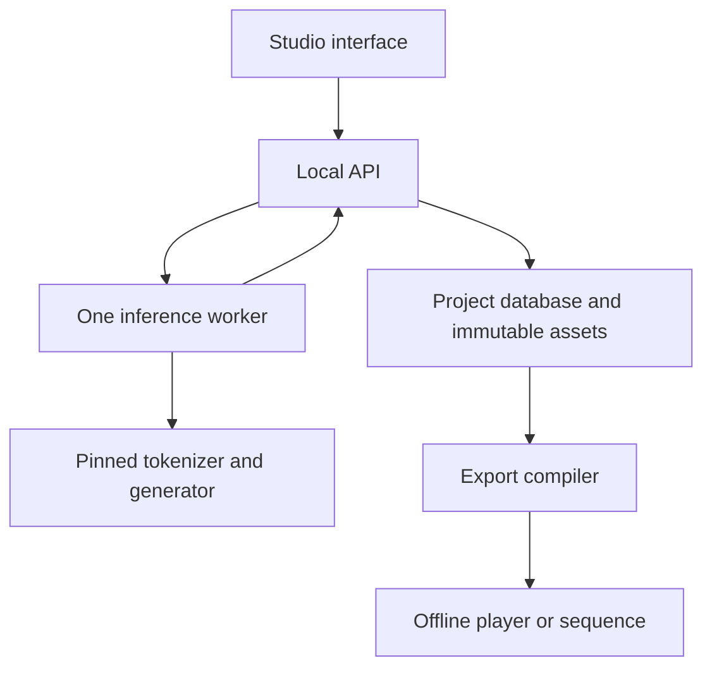

# NCM Art Studio Technical Specification (openwound v4)

Open Wound Version 4.0 · 23 October 2026 · Implementation handoff for a new coding agent

This document contains the product requirements, mathematical adapter contract, implementation plan, and release tests. Read Sections 1–9 for the creative experience, Sections 10–13 for inference, and Sections 14–20 for the application build. Sections 21–22 preserve the longer artistic and investigative vision; Sections 23–24 define the evidence and handoff needed to finish the program. Source links are collected in Section 25.

| Reading route | Main sections |
| --- | --- |
| What the artist can make and how it should feel | 1–2 and 5–9 |
| Exact model, artifacts, and code entry points | 3–4 and 10–13 |
| Architecture, persistence, jobs, API, and exports | 14–19 |
| Build order and completion requirements | 20 and 23–24 |
| Folklore, pattern exploration, and other trajectories | 21–22 |

## 1 Purpose and intended result

Build a complete, usable creative application for Matthew Butler to explore short passages through the learned hierarchy in Next-Concept Modeling. The application must support writing, close reading, variation, collage, repeated retelling, and the production of small games and visual works. It must work with released, frozen models and modest inference resources. Training a new model is not a prerequisite.

The central activity is to supply a passage, inspect how it is reconstructed, generate related versions, choose or edit a version, and continue working from it. The artist must be able to save this work, return to earlier states, compare branches, and export a finished object. A model CLI, notebook, or screen full of diagnostic tensors is an intermediate engineering result, not the completed application.

The first supported model is the released NCM TinyStories tokenizer and generator. Its short, simple language, substitutions, repetitions, and incomplete endings are part of the available material. The application should help the artist discover productive uses of that material. Its ordinary interface must not promise that a latent level represents plot, style, emotion, memory strength, or a universal concept.

The complete vision has three connected parts. The studio produces and curates material. Authoring modes turn that material into reading puzzles, branching games, sequences, and performances. An optional exploration workspace later organizes source families, folklore variants, annotations, and observations about narrative structure. The same saved project should support movement among these activities without requiring a research workflow.

This specification defines a proposed product and its implementation requirements. Statements about NCM are grounded in the pinned paper and repository. Proposed workflows, game rules, and later exploratory modes are application designs; they are not claims that the paper evaluated those uses. The code fragments describe implementation contracts and reference algorithms, with validation requirements stated below. This document is not a claim that the application has already been implemented.

### 1.1 Build priorities

The first usable milestone must expose real progressive reconstructions and real generated variations in a graphical interface, with saving and reopening. The first complete release, called version 1 below, adds donor grafting, bounded retelling sessions, a playable reveal puzzle, a complete Last Account authoring and player workflow, and offline exports. The build order may be incremental, but it must lead to a finished program an artist can use independently.

Implement the required version 1 features before beginning optional extensions. Folklore analysis, additional model families, remote scheduling, live performances, and learned semantic controls must remain possible without becoming prerequisites for ordinary creative use.

When a coding agent is instructed to build this specification, it should complete the requested release and its acceptance criteria. Milestones are implementation checkpoints, not automatic requests for renewed permission. Make routine decisions within these requirements and document material departures.

### 1.2 Product principles

Preserve the artist's agency. Selection, manual writing, interpretation, juxtaposition, and curation are first-class operations. A strange or ungrammatical passage can be retained deliberately. The system must never silently replace a selected passage with a more fluent one.

Make the actual transformations available. Retaining a hierarchy prefix, decoding a partial representation, grafting observed codes, and re-encoding text are distinct operations and must remain distinct in the data. The normal interface can use concise language while an inspectable record preserves their exact meaning.

Spend computation during production when possible. An exported game or sequence must play without Python, PyTorch, model weights, a hosted service, an API key, or a network connection. Live generation is a later option.

Keep the implementation maintainable. Use one inference backend, one persistent project format, one application interface, and a small model-independent player. Add abstractions when a second real use requires them. Avoid distributed services, plugin systems, generic workflow builders, and speculative infrastructure in version 1.

## 2 Creative scope and release boundaries

| Capability | First usable milestone | Required version 1 | Later extension |
| --- | --- | --- | --- |
| Create, save, reopen, and export a project | Yes | Yes | Multiple project libraries |
| Supply a short passage or manually select an excerpt, and see its actual token count | Yes | Yes | Automated segmentation and batches of independent excerpts |
| Progressive reconstruction at all twelve levels | Yes | Yes | Additional compatible tokenizers |
| Generate variations by retaining a hierarchy prefix | Yes | Yes | Additional sampling and adaptive schedules |
| Compare, select, edit, adopt, and revisit passages | Yes | Yes | Larger family comparison views |
| Donor-code grafting at matching levels | No | Yes | Continuous-vector interventions as a separate operation |
| Bounded repeated retelling and anchored retelling | No | Yes | Live autonomous installations |
| Reveal reading puzzle authoring and player | Simple example | Yes | Larger collections and additional question types |
| The Last Account game authoring and player | Play a recorded example | Yes | Live branching during play |
| Offline HTML, text, JSON, and printable sequence exports | Basic text and JSON | Yes | Audio, video, and image-sequence production |
| Source references and simple human tags | Yes | Yes | Folklore families, role relations, and comparative observations |
| Model download, CPU inference, optional CUDA, clear errors | Yes | Yes | Tested MPS acceleration and remote batch execution |
| Model training or general-purpose narrative agents | No | No | Separately scoped projects |

A feature shown as a later extension must have a documented integration point and an honest disabled or absent interface. Do not fill future screens with nonfunctional controls. The artist should see working capabilities.

The first release is a personal, local application. It does not require accounts, collaboration, hosted storage, a public API, or a subscription service. It must still allow portable project archives and finished works that can be shared.

## 3 Sources and reproducible upstream baseline

### 3.1 Pinned references

The scientific source is *Next-Concept Modeling: Fast, Parallel Coarse-to-Fine Text Generation*, arXiv 2610.14162v1. Appendix H, pages 32–34, directly motivates prefix retention, donor mixing, and early-code perturbation. The architecture sections define the residual hierarchy and levelwise generator. [S01]

The inspected upstream repository is `https://github.com/HazyResearch/ncm` at commit:

```text
c70274273f489abc73832b2b98584a8483b6b203
```

The initial model artifact repository is `hazyresearch/ncm-checkpoints` at revision:

```text
d342ce8aaea58830eef3b8ad473664673e41f692
```

Pin these revisions for the first implementation. A newer revision may be supported later through a deliberate adapter update and compatibility checks. Do not silently download whatever is on the main branch.

Keep the upstream MIT license and attribution with any vendored or modified code. Record the source revision and the hash of the application's adapter patch. Model metadata and source-text attribution belong in the project separately from code attribution.

### 3.2 Source map for the builder

| Source | Relevant content | Application use |
| --- | --- | --- |
| Paper, architecture sections and Appendix H [S01] | Residual representation, levelwise generation, retained-prefix and mixing examples | Mathematical interpretation and creative operations |
| `config/eval/tinystories.yaml` [S02] | Model dimensions, level schedule, tokenizer configuration, generation settings | Frozen initial model profile |
| `models/vqvae.py` [S03] | `VQVAE.encode`, `decode`, `_encode_pre_quant` | Source encoding and final decoding |
| `models/quant.py` [S04] | `z_to_idx`, `idx_to_z_q`, `_up_to_full`, `_apply_quant_resi`, `get_next_autoregressive_input` | Code hierarchy and cumulative reconstruction |
| `models/next_concept.py` [S05] | `NextConceptTransformer`, `generate`, head and positional logic | Prefix-conditioned variation adapter |
| `models/vae.py` [S06] | Encoder and decoder tensor conventions | Correct text-grid reconstruction |
| `tokenization/bpe_tokenizer.py` [S07] | Released byte-pair vocabulary, merges, special tokens | Exact text encoding and display decoding |
| `tokenization/vqvae_tokenizer.py` [S08] | Existing text wrapper and length adjustment | Reference behavior; do not copy its silent chunking into the product |
| `scripts/eval_shard.py` [S09] | Checkpoint loading order, level-zero sampling, EOS handling, task-specific final decoding | Inference reference without the benchmark machinery |
| Hugging Face artifact revision [S10] | Frozen TinyStories model files | Download and integrity verification |

Read the referenced functions before adapting them. Do not substitute a generic Hugging Face text-generation pipeline: these checkpoints require the repository's tokenizer and generator implementations.

The release includes evaluation infrastructure rather than a finished creative API. The adapter must expose the required operations explicitly. Do not import `eval_shard.py` as a library; it performs argument parsing, device setup, and evaluation work at module import.

### 3.3 Required TinyStories artifacts

Download only the initial model's files. Offer a reconstruction-only installation containing the tokenizer checkpoint, BPE assets, configuration, and README. Add the generator checkpoint when the artist enables sampled variation, graft-and-regenerate, or sampled retelling. These are component capabilities of the same pinned TinyStories model profile, not incompatible tokenizers. The artwork does not require the tokenized training datasets, GPT-2 evaluation models, all released checkpoints, or benchmark scoring packages.

| Artifact within model repository | Bytes in the pinned revision | SHA-256 where supplied by the Hub |
| --- | ---: | --- |
| `tinystories/generator.pt` | 356160651 | `0acaf4f795390f9f7ccc8f84047867619a1d00e291681e299b855d7e563be6ff` |
| `tinystories/tokenizer.pt` | 221861835 | `76e26003719db32dc3d542518951c286be07d6a5881f29ad5152d299764b0f81` |
| `tinystories/bpe_vocab_8192.pickle` | 95122 | `fb176b4c68108e4b5ef61b9ff2af3731600124e3e160970a6bd78cd0a5d3ff6c` |
| `tinystories/bpe_merges_8192.pickle` | 108277 | `0d4cab13f2e7b684b75eaa290a52e596ba87744ef13d943cf3a50a5a8e080ec1` |
| `tinystories/config.yaml` | 2483 | Compute and store the downloaded file's SHA-256 |
| `tinystories/README.md` | 255 | Compute and store the downloaded file's SHA-256 |

The byte sizes and four listed SHA-256 values were checked against the public Hub metadata for the pinned revision. Small-file Git blob IDs are not SHA-256 file checksums; do not confuse them.

A download helper can use `snapshot_download` with an exact revision and an explicit allow-list. The Hub supports both revision selection and file filtering. [S11]

```python
from huggingface_hub import snapshot_download

snapshot_dir = snapshot_download(
    repo_id="hazyresearch/ncm-checkpoints",
    revision="d342ce8aaea58830eef3b8ad473664673e41f692",
    allow_patterns=[
        "tinystories/generator.pt",
        "tinystories/tokenizer.pt",
        "tinystories/bpe_vocab_8192.pickle",
        "tinystories/bpe_merges_8192.pickle",
        "tinystories/config.yaml",
        "tinystories/README.md",
    ],
)
# Validate expected files and SHA-256 values before loading.
# Resolve the actual model directory as Path(snapshot_dir) / "tinystories".
```

The complete bundle is approximately 578 MB in decimal file bytes; the reconstruction-only installation is approximately 222 MB. The example allow-list above installs the complete bundle; the reconstruction-only installer omits generator.pt. Runtime memory is a separate measurement. The model loader must report missing or corrupt files precisely and support retrying the download without discarding already verified files.

Only the pinned, verified model files may be deserialized by the initial model loader. User project and game imports must use JSON and non-pickled arrays. A user-imported project must never cause an arbitrary Python pickle or PyTorch checkpoint to load.

## 4 What the model supports

The TinyStories text grid has length `L = 128` BPE tokens. These are tokenizer units, not a promise of 128 words. The latent embedding width is `d = 384`; the generator width is `768`. There are twelve code levels, each with a 4096-entry codebook. [S02]

```json
{
  "text_length": 128,
  "latent_width": 384,
  "generator_width": 768,
  "level_lengths": [1, 8, 16, 24, 32, 40, 52, 64, 76, 92, 108, 128],
  "codebook_sizes": [4096, 4096, 4096, 4096, 4096, 4096, 4096, 4096, 4096, 4096, 4096],
  "flat_code_count": 641,
  "generator_conditioning": "unconditional_one_EOS_token",
  "default_retained_level_count": 3,
  "temperature": 1.0,
  "top_k": 0,
  "top_p": 1.0,
  "cfg_scale": 0.0,
  "use_kv_cache": false,
  "use_flex_attention": false
}
```

The first three levels contain 25 discrete codes. Retaining them and generating the remaining nine levels is the paper's qualitative starting point; it is not a universal setting that preserves every story's meaning.

Use one-based level numbers in the artist interface and zero-based indices in code. API fields named `retained_level_count` contain a count from zero through twelve. An individual code location uses `level_index` from zero through eleven and `position` within that level. Convert between them at the presentation boundary and test the conversion.

The TinyStories generator is not an instruction-tuned chat model. Its text prefix in the released unconditional path is one EOS token. An artist's source passage is encoded by the VQ tokenizer; it is not inserted into that one-token generator prefix. [S02], [S09]

Keeping an early latent prefix fixes those code indices. It does not guarantee exact words, a fact, or a human-defined plot. Human labels and game conditions must therefore be stored outside the model.

A progressive reconstruction uses a fixed encoded hierarchy. A generated variation samples a new suffix of a hierarchy. Re-encoding a selected text creates a new hierarchy, which need not match the codes that originally generated that text. The application must preserve these distinctions.

## 5 Source text and passage identity

Every passage revision must preserve exact UTF-8 source text. Do not silently normalize punctuation, replace quotation marks, collapse whitespace, correct grammar, or finish an incomplete sentence. An artist may explicitly make those edits, producing a new revision.

Use the released BPE vocabulary and merges. Count tokens before submitting inference. For the initial profile, a nonempty model input must fit within 128 BPE tokens. Pad shorter inputs to 128 using the released PAD ID. The default source-encoding policy does not append EOS; this follows the source wrapper's padding behavior. The generator's one-token EOS conditioning remains a separate operation.

Long text must remain intact in the source record. Version 1 must offer manual selection of a single excerpt that creates a linked passage revision. Show the chosen excerpt and its token count before encoding. Automated segmentation and batch generation over independent excerpts are later extensions. Do not silently split a folktale into independent chunks and present the result as a coherent long-form model run.

Store original source text, the exact model-input text, raw decoded token IDs, a decoded display version, and any human-edited revision as separate fields or related records. They may have identical values, but they are different kinds of evidence.

For ordinary generated text display, reproduce the TinyStories evaluation policy: find the first EOS, display the preceding tokens, remove EOS/PAD special tokens, and decode the remaining bytes through the released tokenizer. Preserve all 128 raw token IDs even when the visible text is empty or short. The UI should have a small optional raw view; it should never invent prose when decoding produces an empty result.

A diagnostic view may display all non-special decoded tokens without cutting at the first EOS. That is a separate display policy with its own identifier. It must not silently become the input to a later retelling.

Manual edits create an immutable child passage revision. Reusing the edited passage for inference requires encoding the edited text. The prior hierarchy must remain associated with its original input and run.

## 6 The studio experience

The default workspace should feel like a writing desk. Use a quiet, readable interface with a project list, a main passage editor, candidate passages, and a compact history. Put tensor details, hashes, sampling controls, and provenance in an inspector that can be opened when useful.

The initial navigation contains Studio, Sequences, Works, and Sources. Studio provides reconstruction, variation, and grafting. Sequences organizes repeated transformations. Works contains the two game authoring modes and sequence exports. Sources preserves original texts and references. A later Explore area can add folklore comparisons without changing these basic workflows.

The current passage and its source should remain legible at a comfortable reading width. Candidate cards should show complete short passages, not force the artist to hover over truncated snippets. Use optional word-level diff highlighting that preserves punctuation and allows unhighlighted reading. Diff is a comparison of text, not a visualization of which code means which word.

Provide clear pending, running, complete, cancelled, and failed states for every model operation. Keep editing and navigation responsive while inference runs. Show useful progress such as candidate number and level number; do not report a fabricated percentage of semantic completion.

Autosave the current working draft separately from immutable passage revisions and restore it after restarting the application. Explicit saving or submission for inference creates or selects the immutable revision used by the operation. Undo and redo must work for ordinary editing. Restoring an earlier saved passage must not delete later descendants.

A completed job must not replace selected text, change the current source, or take focus from an editor. Its candidates remain attached to its original input even if the artist has moved elsewhere. Notify the artist that results are available and let adoption remain explicit.

Make the full workflow usable by keyboard. Candidate selection, level stepping, editing, and game choices need visible focus states. Text differences must use labels or decoration in addition to color. Animated sequences need pause, manual stepping, speed control, and reduced-motion behavior. Screen readers should receive a completed-state announcement rather than every changing token.

### 6.1 Progressive reconstruction

The artist selects a passage and chooses Reconstruct. The backend encodes it once and reconstructs the accumulated full-grid state after each of the twelve levels. The interface presents a slider or twelve discrete steps, a current reconstruction, and an optional comparison with the original.

Allow the artist to pin a level, compare two levels side by side, play the sequence forward or backward, and choose the timing of each frame. Reverse playback reverses a saved reconstruction sequence; it is not a new learned forgetting process.

The final decoded reconstruction must be displayed as the model's reconstruction. Keep the exact authored original separately available. If the two differ, do not silently replace the model's final frame with the original.

A reconstructed frame can be copied into a new passage revision. Its provenance must identify the source hierarchy and reconstruction level. If the artist edits or regenerates it, the new operation begins from that explicitly selected text.

### 6.2 Variation Desk

The artist selects a passage, chooses a retained level count, and asks for a small batch of variations. Default to three retained levels and four candidate requests, executed one at a time in the initial reference path. Keep the exact retained-level control visible in the normal workspace. Provide an advanced panel for temperature, top-k, top-p, and seed.

Normal Vary encodes the exact persisted text of the selected passage revision and branches from that encoding. Adopting a generated candidate selects or materializes a revision containing its explicitly chosen decoded view; a later Vary must not silently reuse the ancestor passage that originally conditioned that candidate. Resample stored hierarchy is a separate advanced operation that branches from saved generation codes. Adopting a candidate does not declare that re-encoding and reusing its generated hierarchy are equivalent.

Each candidate card supports Adopt, Edit as new revision, Compare, Save, and Reject. Reject is an organizational decision, not deletion of an ancestor needed by existing work. A duplicate candidate should be marked as a duplicate rather than silently resampled without consuming the recorded request budget.

Returning to a prior passage restores a saved selection. Generating again creates new runs. The artist can pin a source and compare many descendants against it without moving the current selection.

At retained count twelve, present the operation as reconstruction with no stochastic suffix. At retained count zero, present it as a fresh unconditional story that does not inherit source codes. These endpoints are useful but should not be misleadingly described as ordinary slight variations.

### 6.3 Donor grafting

The artist chooses a base and donor passage encoded with the same exact tokenizer profile. Show the two passages side by side. The simple control chooses a target level and one or two code positions. An advanced grid can select positions explicitly.

Default donor mapping uses the same level and position in the donor. Record every replacement, including the original and replacement code IDs and the donor encoding. Do not transfer raw code IDs between models or tokenizer revisions.

To perform an ordinary graft at level j, retain the base levels through j, replace the selected codes within those retained levels, and regenerate every level after j. Unmodified positions in the retained levels stay fixed. Multiple selected levels are allowed if the retained count includes the deepest selected level. Codes after that retained prefix must be generated afresh.

Allow paired base and grafted runs with the same requested seed and settings for comparison. Describe them as paired runs; different numbers of random draws or a different sampling path can still change random-stream alignment. Avoid attributing every changed word to one particular code.

A later advanced destructive-splice operation may retain an incompatible fine suffix deliberately. It must use a different operation identifier and label because it is not the ordinary graft-and-regenerate procedure.

### 6.4 History and family comparison

Show a readable ancestry list with expandable branches. Each passage should identify whether it was authored, imported, decoded, generated, or manually edited. Multiple provenance parents are possible for grafts.

Selecting a node should show its direct source, operation, and chosen settings without loading model weights. The artist should be able to compare siblings, compare a descendant with its distant ancestor, add notes, and mark a passage as part of a work.

Provide a compact tree initially. A freely navigable graph with hundreds of nodes is an extension, not a prerequisite for saving and finding an interesting result.

## 7 Sequences and Memory Weather

A sequence is an ordered set of saved passage or frame references with timing and presentation metadata. It can be assembled manually or produced by an explicit retelling recipe.

For repeated retelling, start from a saved passage, encode its selected input text, retain a specified number of levels, generate one or more candidates, choose the next passage, and repeat. In an automatic sequence, selection is governed by a declared rule such as first candidate or a seeded candidate index. In an artist-guided session, the artist chooses each next passage.

This loop uses frozen weights. Its persistence comes from the stored current passage and the transition rule. Store every completed step and its parentage so the artist can stop, branch, return to an earlier state, or export the sequence.

Version 1 must require a finite step count, a candidate cap, and an explicit start action. Default to a small session, such as eight steps with one generated candidate per step. Never start an unbounded autonomous loop when a project opens.

A recipe contains the source revision, retained count or explicit count schedule, sampling settings, seed policy, number of steps, and optional anchors. A fixed count schedule is simply a list of retained counts indexed by iteration; it does not assert that those counts are equivalent amounts of semantic change.

An anchor is an explicit return to a saved passage or a recorded graft from an earlier encoding. Support a simple periodic source reset in version 1. Store the reset as an operation, so the archive shows where external material re-entered the lineage. More complex partial anchors can be added through the graft operation.

Provide an encode/decode-only loop as a separate recipe. It repeatedly reconstructs and re-encodes without sampling a generator suffix. This offers different artistic material and a clear way to see the contribution of reconstruction itself.

An empty visible result is a valid recorded generation outcome. Save that completed step and pause the retelling session with “No text available for the next cycle.” The artist can select another candidate, choose a new source, or finish the sequence. Apply the same explicit pause if the exact next text fails the input-token limit after re-tokenization. Do not substitute a diagnostic raw view, invent text, truncate silently, or retry automatically to keep the loop running.

Export a sequence as readable text, machine-readable JSON, printable HTML, and an offline timed HTML presentation. Preserve frame duration, order, and pause points. The artist can rearrange the presentation order without altering the underlying provenance order.

## 8 Reveal puzzle authoring and play

A reveal puzzle uses one fixed source hierarchy and a selected subset of its progressive reconstructions. The final source exists from the start. The player's activity is to commit to an interpretation before requesting every reveal.

The author chooses the passage, reviews all twelve reconstructions, selects which frames will be used, writes a question, provides two to four answer choices, and identifies the correct choice. The answer comes from the author's source and annotation; the system must not ask another model to adjudicate it.

Support a collection of one or more puzzles. For each puzzle the player can reveal the next selected frame or submit an answer. The interface must make irreversible submission clear. The result records correctness and the number of reveal requests after the initially visible frame. For a collection, compare total correct answers first and fewer total reveal requests second, lexicographically as (correct_count, -reveal_requests). A faster incorrect answer must never outrank a correct answer. Scoring is an authored game rule and can be disabled for a reflective mode.

The author may choose an exact-source reveal after the answer. It must be distinguished from the model's final reconstruction in the working record and optional credits. Do not label the original text as an additional neural reconstruction frame.

Provide preview from the player’s perspective, frame selection, question editing, answer validation, restart, and a final review of the puzzle. The default reveal template orders selected levels strictly increasingly; arbitrary reordering belongs in the sequence editor or a future explicitly described custom puzzle. A valid puzzle has at least two reveal frames, a nonempty question, unique answer identifiers, and one correct answer identifier that actually exists.

Export a complete, keyboard-usable offline HTML player with the selected frames and authored content embedded. Export must not depend on a development server or fetching a neighboring JSON file under file://.

## 9 The Last Account authoring and play

The Last Account is a finite branching work about carrying an account through successive changes. The initial template uses one source incident, three authored concerns, four rounds, and two choices at every nonterminal node. A complete four-round binary tree has 31 reachable nodes and 16 leaves. The artist may create shorter works; a small validated two-round fixture is specified below.

The concerns are facts or relationships the author asks the player to preserve. They might concern who borrowed an object, what the object was, or whether a promise was fulfilled. These goals are game data. They are not instructions sent to NCM.

The author generates candidate passages in the studio, chooses which versions create interesting decisions, places them in a game, annotates their relationship to the goals, and writes endings. Curated game navigation can use passages from different branches, but that must not manufacture model ancestry.

### 9.1 Authoring workflow

Create a work from a selected source passage and choose its number of rounds. Define one to five goals with stable identifiers and reader-facing descriptions. The default template contains three.

For each nonterminal node, select or generate two candidate next accounts. Preview the complete text of both candidates. The author can manually revise a candidate, but doing so creates a new passage revision and invalidates its previous semantic assessments for review.

A node's text is bound to a specific passage revision. Every goal has an authored assessment for that exact passage revision and goal-definition revision: `preserved`, `changed`, or `unclear`. Include a short optional rationale. Rebinding a node or changing a goal creates pending review requirements. Assessments on older frozen text and goal revisions remain intact, including those in previously exported works. Do not infer these assessments by searching for a keyword; who owns a kite is different from whether the word kite appears.

The author chooses whether the original source and goals stay visible during play. The initial template shows them at the start, keeps the goals available, and hides the original text until the ending. This is a work setting, not a hardcoded psychological experiment.

A branch preview shows the selected path, current passage, next choices, current round, and possible ending. Provide an author-only completeness view identifying missing choices, missing assessments, stale revisions, unreachable nodes, and absent endings. The author must be able to repair these problems in the interface.

### 9.2 Default scoring and endings

Default scoring uses the final account. Award one point for each goal assessed as preserved at the terminal node. Changed and unclear each award zero. A fact that disappears in an intermediate account and returns in the final account counts as preserved under this rule.

Continuous retention is an optional separate rule. Under that rule a goal scores only if it is preserved at every selected node. Store the rule identifier in the work and explain it to the player. Do not mix the two definitions implicitly.

The artist can disable numeric score and use authored ending text alone. Endings may be attached directly to leaves or selected from explicit score bands; a directly authored leaf ending takes precedence. A model is not needed to generate the verdict.

At the end, show the final account, original account, selected path, and the authored goal assessments. Offer restart and an optional route review. Do not require revealing every possible ending to complete one playthrough.

### 9.3 Initial fixture

The following seven passages are original authored test fixtures. They are not NCM outputs. Store them with `origin_kind = authored_fixture`; they test navigation and scoring before real generated assets are available. A user-facing model demonstration must later include genuine inference artifacts.

Goals: G1 Anna is the borrower. G2 The borrowed object is a red kite. G3 The borrowed object is returned to Ben before dark.

| Node | Passage | G1 | G2 | G3 | Children |
| --- | --- | --- | --- | --- | --- |
| root | Anna borrowed a red kite from Ben. She promised to return it before dark. Before sunset, she came back and put the kite in Ben's hands. | preserved | preserved | preserved | a and b |
| a | Anna borrowed a red kite from Ben. She promised to bring it back. When the stars came out, she returned and gave the kite to Ben. | preserved | preserved | changed | aa and ab |
| b | Anna borrowed a blue kite from Ben. She flew it beside the gate. Before sunset, she returned it to Ben. | preserved | changed | preserved | ba and bb |
| aa | Anna had borrowed a red kite from Ben. Long after dark, she knocked at his door and returned the kite. | preserved | preserved | changed | terminal |
| ab | Ben borrowed a red kite from Anna. Before sunset, he returned the kite to Anna at the gate. | changed | preserved | changed | terminal |
| ba | Anna borrowed a red kite from Ben. She came back before dark and placed the borrowed kite in his hands. | preserved | preserved | preserved | terminal |
| bb | Anna borrowed a blue kite from Ben. She left the gate with it. Much later, someone found a kite beside the path. | preserved | changed | unclear | terminal |

Final-state leaf scores are 2, 1, 3, and 1 for aa, ab, ba, and bb. Continuous-retention scoring gives ba only 2 because the path through b changes G2 before restoring it. This is a required engine test.

The fixture includes four authored endings so it is a complete playable work. For aa: “The object and its borrower remain, but the promise has slipped past dusk.” For ab: “The account returns the kite by changing whose story it was.” For ba: “The final account agrees with the first, though one version on the way did not.” For bb: “The account preserves a borrower and leaves the return unresolved.” These are authored test passages, not NCM outputs.

The default production template remains four rounds. Do not generate its full tree automatically merely because a template exists. Let the author populate nodes deliberately, with a bounded candidate budget and progress visible.

### 9.4 Player and export

The player presents readable passages and meaningful choices. It does not expose code IDs, hashes, model memory, or sampling diagnostics during ordinary play. A credits or process view may describe how the work was made.

Store play progress locally under the work's immutable version fingerprint. Restart must clear only that playthrough. When a revised work is loaded, an incompatible old save must not be applied to changed node identifiers.

A finite game must validate as a rooted acyclic graph, with the selected template enforcing its depth and branching count. Every edge must resolve, every reachable terminal must have a valid result, and every reachable node must reference a frozen passage snapshot. A work can later support general DAGs, but the first template should use a tree.

Export includes a frozen snapshot of all public game content. It must remain unchanged if the artist edits the studio project afterward. The player must open by double-clicking one HTML file and work with networking disabled. It may save progress in browser storage when available and must remain playable when storage is unavailable.

## 10 Mathematical model for the adapter

This section gives the mathematical operations the application must implement. Keep the pretrained architecture intact. The studio is an inference and composition layer.

### 10.1 Residual code hierarchy

Let x be a length-L array of text token IDs, with L = 128 after padding. The tokenizer encoder and its normalization produce z with shape [B, L, d]. The initial cumulative latent is zero.

For zero-based level k, with length ell_k, quantize a downsampled residual against that level's codebook E_k:

```math
u_k = \operatorname{Down}_k(z-\hat z_{k-1}), \qquad
r_{k,i} = \operatorname*{argmin}_j \|u_{k,i}-E_{k,j}\|_2^2.
```

Look up the chosen embeddings, resize them to the full text grid, apply the learned residual transform, and accumulate:

```math
\Delta z_k = \Phi_k(\operatorname{Up}_k(E_k[r_k])), \qquad
\hat z_k = \hat z_{k-1}+\Delta z_k.
```

The final level already has full length but still requires its residual transform. In the pinned TinyStories profile, the residual transform combines an identity path and a learned convolution with ratio 0.5. Reuse the loaded module; do not replace it with a generic interpolation, average, or manually invented filter. The first-level resizing uses learned cascaded sampling. [S03], [S04], [S06]

The decoder maps a cumulative latent of shape [B, L, d] to token logits of shape [B, L, 8192]. The TinyStories reference decode takes argmax at every text position. Progressive reconstruction decodes each cumulative full-grid state. It does not decode an isolated residual contribution.

The full hierarchy contains 641 categorical codes. It is a hierarchy of decisions with fewer sequential prediction stages, not necessarily a smaller stored representation than the original token sequence.

### 10.2 Parallel next-level generation

The generator conditions on the previous cumulative representation and fixed context c. For TinyStories, c is one EOS token. It predicts a level's code positions independently conditional on those shared inputs:

```math
p_\theta(r_{m:K-1}\mid r_{0:m-1},c)
=
\prod_{k=m}^{K-1}\prod_{i=1}^{\ell_k}
p_\theta(r_{k,i}\mid \hat z_{k-1},c).
```

This equation applies to 1 <= m <= K and describes retaining m complete levels and generating the remainder. For m=0, the released TinyStories path samples the first code from the checkpoint's empirical unigram distribution q_0, then predicts subsequent levels:

```math
p(r_{0:K-1}\mid c)=q_0(r_0)\prod_{k=1}^{K-1}\prod_{i=1}^{\ell_k}p_\theta(r_{k,i}\mid\hat z_{k-1},c).
```

Within-level predictions can run in parallel. The decoded text shown after an intermediate level is an observation of the latent state; it is not fed back as text to the next level.

An ordinary retelling explicitly adds that missing text feedback:

```math
r^{(t)} = Q(E(x_t)), \qquad
\tilde r^{(t)}_{m:K-1}\sim p_\theta(\,\cdot\mid r^{(t)}_{0:m-1},c), \qquad
x_{t+1} = \operatorname{DisplayDecode}(r^{(t)}_{0:m-1},\tilde r^{(t)}_{m:K-1}).
```

DisplayDecode includes the recorded EOS and special-token policy. Re-encoding that exact resulting text is an explicit next operation. The repeated loop is an artistic application of the primitive, not a new capability that must be learned before the tool works.

### 10.3 Sampling

For code logits a and a positive temperature tau, the unfiltered probabilities are proportional to exp(a/tau). Use the upstream filtering and sampling order in the reference adapter. Temperature zero selects argmax.

Validate finite temperature greater than or equal to zero, integer top-k satisfying 0 <= top_k <= 4096, and finite top-p greater than zero and no larger than one. Zero top-k disables that filter. Reject invalid settings with an actionable message; do not silently clamp them. Pass the released defaults explicitly because the upstream Python method has different default arguments.

Numerical code IDs are categorical labels. Arithmetic interpolation of IDs is not an embedding interpolation. A future vector-interpolation experiment must operate on codebook vectors, name its continuous operation separately, and preserve its potentially off-distribution character in the run record.

### 10.4 Tensor and index contracts

| Value | Shape in the initial profile | Notes |
| --- | --- | --- |
| Source token IDs | [B, 128] | Long integer, padded before encoding |
| Encoded latent | [B, 128, 384] | Adapter canonical layout |
| Code indices at level k | [B, ell_k] | Own codebook range |
| Flat complete hierarchy | [B, 641] | Concatenated in level order |
| Looked-up level embeddings | [B, ell_k, 384] | Before resizing |
| Cumulative reconstructed latent | [B, 128, 384] | Required decoder input |
| Next-level generator input | [B, ell_(k+1), 384] | Downsampled cumulative state |
| Generator hidden level | [B, ell_k, 768] | After input projection |
| Text logits | [B, 128, 8192] | Final axis is text vocabulary |
| Generator context IDs | [B, 1] | EOS; different from source text |

Convolution internals may transpose to [B, d, L]. Restore the canonical layout before calling the decoder.

Use these offsets for splitting flattened codes:

```python
LEVELS = [1, 8, 16, 24, 32, 40, 52, 64, 76, 92, 108, 128]
OFFSETS = [0, 1, 9, 25, 49, 81, 121, 173, 237, 313, 405, 513, 641]
```

For a predicted absolute level j greater than zero, the generator head and RoPE index are j - 1. Its target-level embedding slice begins at sum(LEVELS[1:j]), not OFFSETS[j]. The first level has no generator target slot in this profile. Advancing this slice is required even when an intervening retained level skips a prediction.

## 11 Model loading and implementation corrections

Load components lazily. Reconstruction, reveal-frame production, and encode/decode-only loops require only the tokenizer and decoder. Editing, history review, and saved-work playback require no loaded model. Load and validate the tokenizer configuration and BPE assets first. Load the tokenizer checkpoint strictly, then move the tokenizer to the chosen device, set evaluation mode, and disable gradients. When an operation needs the generator, construct it only after the correct tokenizer weights are loaded.

This order matters because the tied generator heads copy codebook-derived quantities into nonpersistent buffers during construction. Constructing the generator against a random tokenizer and loading the real tokenizer later can leave incorrect head buffers even if the generator state dictionary loads strictly.

The tokenizer is held in `net.vqvae_local` as an unregistered tuple. Calling `net.to(device)` or `net.eval()` does not automatically move or change the tokenizer. Manage the two components explicitly. Assert the actual device and evaluation state before every supported operation.

Use strict state-dictionary loading and fail on incompatible shapes or missing keys. Resolve model paths against the model-bundle directory, never an incidental working directory. Derive EOS and PAD IDs from the loaded tokenizer and verify that they differ.

The initial adapter is specialized to the TinyStories configuration: raw token prefix, one EOS position, no context encoder, no query-level-zero path, no predicted-level-zero head, RoPE, level embeddings, block-diagonal attention, and no optional post-upsampling convolution. Assert these conditions. A future conditional model requires a different verified profile.

### 11.1 Required corrections and avoided paths

| Upstream behavior | Studio requirement |
| --- | --- |
| `VQVAE.reconstruct` unpacks three quantizer outputs although the quantizer returns five | Use encode followed by decode, or apply a small documented correction |
| `idx_to_zhats` appends references to an accumulator modified in place | Store independent snapshots or decode immediately; never treat aliased entries as distinct states |
| Helper `z_levels` are downsampled to the current level length | Reconstruct all displayed frames from the cumulative full 128-position grid |
| Existing `generate(idx, ...)` takes the first-level code, not an arbitrary hierarchy prefix | Add a validated fixed-prefix adapter |
| The public tokenizer wrapper silently chunks overlength inputs | Require an explicit excerpt or independent-excerpt batch |
| Some text wrappers create CPU tensors or assume unavailable batch decoding helpers | Move inputs explicitly and decode rows through the actual BPE API |
| Python generation defaults differ from the released TinyStories settings | Pass all sampling parameters explicitly |
| Optional KV-cache and other task paths are not required here | Keep them disabled until a separate feature and equivalence test justify them |

Use a narrow adapter or a clearly maintained patch layer. Keep upstream source recognizable and retain its license. Do not refactor the entire research repository to make the first artwork.

## 12 Reference inference algorithms

The following reference snippets are tied to the pinned upstream API. They omit application persistence, user-facing errors, and complete validation for readability. The implemented adapter must add those contracts. Core accumulation and prefix-control logic was checked with a tiny random-weight upstream model during preparation of this specification; a real TinyStories smoke run remains a release gate.

### 12.1 Encode one selected passage

```python
import torch

@torch.inference_mode()
def encode_source(text: str, tokenizer, device):
    ids = tokenizer.pre_tokenizer.encode(text)
    if not ids:
        raise ValueError("Enter a nonempty passage.")
    if len(ids) > 128:
        raise ValueError("Select a passage of at most 128 BPE tokens.")
    pad_id = tokenizer.pre_tokenizer.pad_token_id
    padded = ids + [pad_id] * (128 - len(ids))
    token_tensor = torch.tensor([padded], dtype=torch.long, device=device)
    codes = tokenizer.vqvae.encode(token_tensor)
    assert codes.shape == (1, 641)
    return token_tensor, codes
```

Persist the unpadded count, exact input text, padded token IDs, model profile, encoding policy, and output codes. The literal source remains separate from its reconstruction.

### 12.2 Full-grid reconstruction trace

```python
@torch.inference_mode()
def reconstruct_trace(vqvae, flat_codes):
    levels = list(vqvae.vq.levels)
    batch_size = flat_codes.shape[0]
    assert flat_codes.shape[1] == sum(levels)
    parts = torch.split(flat_codes, levels, dim=1)
    state = torch.zeros(
        batch_size, levels[-1], vqvae.embed_dim,
        device=flat_codes.device,
        dtype=torch.float32,
    )
    trace = []
    for level_index, codes in enumerate(parts):
        embedding = vqvae.vq.embeddings[level_index](codes)
        state, next_generator_input = (
            vqvae.vq.get_next_autoregressive_input(
                level_index, state, embedding
            )
        )
        # Decode the full-grid accumulator, not next_generator_input.
        snapshot = state.detach().clone()
        logits = vqvae.decoder(snapshot)
        raw_ids = logits.argmax(dim=-1)
        trace.append({
            "completed_levels": level_index + 1,
            "raw_token_ids": raw_ids.detach().cpu().clone(),
        })
    return trace
```

The final iteration must apply the final residual contribution. Compare the final state against `vqvae.vq.idx_to_z_q(flat_codes)` and final logits against `vqvae.decode(flat_codes)`. Equality to the original text is not the same test.

Default persistence stores code indices and decoded token snapshots rather than all floating-point latent tensors. Optional analysis exports can include tensors later with explicit storage costs.

### 12.3 Retained-prefix variation

```python
@torch.inference_mode()
def branch_tinystories(
    net, vqvae, source_codes, retained_level_count,
    eos_id, level0_unigram, sampling, on_level=None
):
    # Caller validates bundle identity, integer ranges, sampling settings,
    # and the specialized TinyStories configuration.
    # Caller also provides a serialized, scoped RNG context.
    levels = list(vqvae.vq.levels)
    level_count = len(levels)
    m = int(retained_level_count)
    assert 0 <= m <= level_count
    assert net.prefix_len == 1 and net.use_rope
    assert net.config.raw_token_prefix and net.config.use_level_encoding
    assert not net.query_level0 and not net.predict_level0
    assert not net.use_ctx_encoder and not net.use_post_upsample_conv
    assert net.config.attn_pattern == "block_diagonal"
    device = next(vqvae.parameters()).device

    fixed = None
    if m > 0:
        fixed = torch.split(source_codes, levels, dim=1)
        code = fixed[0].clone()
    else:
        # The release samples the first-level empirical distribution on CPU.
        weights = level0_unigram.detach().float().cpu()
        code = torch.multinomial(
            weights, levels[0], replacement=True
        ).reshape(1, levels[0]).to(device)

    prefix_tokens = torch.full(
        (1, 1), eos_id, dtype=torch.long, device=device
    )
    prefix_emb = net.transformer.wte(vqvae.encoder.wte(prefix_tokens))
    level_pos_embed = net.transformer.wle(net.lvl_1L)
    state = torch.zeros(
        1, levels[-1], vqvae.embed_dim,
        dtype=torch.float32, device=device
    )
    result = []
    target_offset = 0
    net._cfg = None
    try:
        for j in range(level_count):
            if j > 0:
                if j < m:
                    code = fixed[j].clone()
                else:
                    hidden = net.transformer.wte(next_input)
                    hidden = hidden + level_pos_embed[
                        :, target_offset:target_offset + levels[j], :
                    ]
                    logits = net._decode_level_logits(
                        hidden, prefix_emb, level_idx=j - 1,
                        pad_bias=None, hidx=j - 1
                    )
                    code = net._sample_level(
                        logits, sampling.temperature,
                        sampling.top_k, sampling.top_p
                    )
                # Advance even when this level was retained without sampling.
                target_offset += levels[j]

            result.append(code.clone())
            embedding = vqvae.vq.embeddings[j](code)
            state, next_input = (
                vqvae.vq.get_next_autoregressive_input(
                    j, state, embedding
                )
            )
            if on_level is not None:
                on_level(j + 1, code.detach().clone(),
                         state.detach().clone())
    finally:
        net._cfg = None

    return torch.cat(result, dim=1)
```

The callback may save a preview or check cancellation but must not draw from the inference RNG. Its state argument is a full-grid independent snapshot. The `pad_bias=None` shortcut is valid only for this unpadded single-EOS context; do not copy it into a conditional prompt adapter.

At m = 0, sample the first level from `generator_checkpoint["inference"]["level0_unigram"]`; no source codes are inherited. At m = 1, retain the first code and make eleven predictions. At m = 3, retain 25 codes and make nine predictions. At m = 12, return the complete retained hierarchy with zero generator predictions or random draws. The application can optimize m = 12 without loading the generator.

Validate the empirical first-level weights for correct size, finite nonnegative entries, and positive total. The reference multinomial call accepts unnormalized weights; do not introduce an unnecessary transformation of the supplied distribution.

The final saved text is obtained by decoding the complete returned hierarchy with the tokenizer. The generation loop above also accumulates the last level so a captured final trace is correct.

### 12.4 Donor graft recipe

Start from an independent copy of the base hierarchy. For each mapping, read the donor's code at the declared same level and donor position, save the replaced base code, and write the donor code at the target position. Require retained_level_count to be greater than the highest zero-based modified level. Then call the ordinary prefix-branch adapter using this modified hierarchy as the retained source.

Do not modify cached base or donor tensors in place. A graft run has two provenance inputs and a complete replacement map. If a selected prefix contains no actual differing codes, retain the run as an explicit no-op graft rather than fabricating a change.

## 13 Reproducibility and sampling identity

Use one completed candidate per seeded inference call in the first execution profile, even when the interface requests several candidates. This avoids making an existing candidate's identity depend on a later change in batch size.

Represent user seeds as unsigned 32-bit integers so they round-trip through JSON and JavaScript. Candidate zero uses the requested base seed. Derive subsequent candidate seeds by taking the first four bytes of SHA-256 of the UTF-8 string `ncm-art-seed-v1:<base_seed>:<candidate_index>`, interpreted as a big-endian unsigned integer. Store each explicit seed, not just the recipe. For an iterated sequence, materialize its complete finite seed schedule before submission.

The pinned sampler uses PyTorch's process-global random state. The initial worker must serialize calls and scope RNG state around each candidate. Include CPU and every visible CUDA device that will be seeded; alternatively expose exactly one CUDA device to the worker. A job must not interfere with another job's RNG state. A later adapter may pass an explicit torch.Generator through the sampler, but that change needs a new execution-profile version.

Use evaluation mode, `torch.inference_mode()`, FP32, and the eager path as the initial correctness profile. Set and record deterministic settings where supported. Keep any accelerated profile separate. PyTorch does not guarantee identical numerical results across releases, devices, or platforms, even with identical seeds. [S12]

The durable replay record is the saved text, raw tokens, codes, and recipe. Replaying a finished game is exact because it uses stored results. Re-running numerical inference is reproducible within the recorded compatible environment as checked by tests; it is not promised to be bit-identical on every device.

Record the model and tokenizer hashes, upstream revision, adapter revision, Python and PyTorch versions, device kind, relevant accelerator version, dtype, attention implementation, batch size, seed policy, explicit seed, and all effective sampling settings. This information is automatic and belongs in the inspector and project export, not in the normal game flow.

Changing a seed can produce the same result by chance. A test must not require every pair of seeds to generate different text. Preview decoding, job progress, UI browsing, and exporting must not change the sampled hierarchy.

## 14 Application architecture

Use a local Python backend with PyTorch inference, FastAPI for a typed HTTP interface, Pydantic for request and record validation, SQLite for project metadata, and immutable JSON or numeric-array assets for model results. Use a lightweight TypeScript interface built with Vite and React. The model-independent player should be a small TypeScript module compiled into standalone exports.

The backend serves the compiled interface from the same loopback origin. One launcher starts the service and opens the browser. Bind to loopback by default. Remote model execution later uses explicit batch files, not an exposed unauthenticated workstation API.

Use one spawned inference worker process with one active candidate computation. The service owns the project database; the worker communicates through bounded job and result messages. This prevents inference from blocking the interface and separates model state from HTTP request threads. Use the spawn start method for accelerator-compatible process initialization, and initialize accelerator resources inside the worker. [S13]

Polling job status is sufficient initially. A later server-sent-events stream may improve progress reporting. A distributed task broker, WebSocket framework, Redis, or container orchestration is unnecessary for the first local application.

A small capability-based adapter interface should expose tokenize, encode, reconstruct, branch, and graft. Only TinyStories needs to implement all of those capabilities initially. Do not make the UI guess capability from a model's name.



### 14.1 Module ownership

| Module | Owns | Must not own |
| --- | --- | --- |
| `model_adapter` | Tensor operations, configuration guards, code validation, device behavior | Game rules or UI state |
| `jobs` | Durable recipes, queue state, cancellation, result commits | Literary interpretation |
| `projects` | Revisions, sources, provenance, assets, migrations | Numerical model internals |
| `studio` | Editing, comparisons, selections, previews, notes | Hidden preprocessing |
| `works` | Game nodes, goals, annotations, validation, authored endings | Invented neural ancestry |
| `player` | Frozen work navigation, reveal logic, score, local save | Model inference or project mutation |
| `exports` | Frozen snapshots, manifests, offline packages, credits | Silent content rewriting |
| `explore` | Later collections and comparisons using saved records | Automatic claims of universal structure |

### 14.2 Proposed repository organization

```text
ncm-art-studio/
  README.md
  SPEC.md
  AGENTS.md
  pyproject.toml
  dependency-lock-files
  backend/
    ncm_art/
      api/
      domain/
      storage/
      jobs/
      model_adapter/
      exports/
      cli.py
  frontend/
    src/
      studio/
      sequences/
      works/
      sources/
      shared/
  player/
    src/
  vendor/
    ncm/
  model_profiles/
    tinystories-v1.json
  fixtures/
    authored/
    recorded/
  tests/
    adapter/
    persistence/
    games/
    browser/
  docs/
    setup.md
    architecture.md
    model_adapter.md
    project_format.md
    decisions.md
```

These paths describe the new project, not files that already exist upstream. Vendor or pin upstream in a way that a fresh checkout can obtain the exact revision. A submodule is acceptable only if bootstrap initializes it reliably. A small vendored copy with preserved license and documented patches is also acceptable.

Keep Python imports deterministic. Upstream uses top-level imports such as `models` and `utils`; contain any path adjustment inside the worker's adapter bootstrap and verify that the imported modules originate from the pinned vendor directory. Do not allow unrelated installed packages with those generic names to be imported accidentally.

Use Python 3.12 as the initial reference environment. Select compatible dependency versions during bootstrap and commit exact lock files. The numerical reference checks described in this specification ran with PyTorch 2.14.1+cpu. CUDA builds need their own tested installation instructions. The frontend must also pin its package manager, runtime requirement, and dependency lock after the initial working setup; ordinary app launch must not install packages from the network.

A native desktop wrapper can be added later if it improves distribution. The initial software does not need to port PyTorch inference into Rust or introduce an additional native application framework.

## 15 Project records and persistence

A project must remain useful when the model is not loaded. Reading, editing, comparison, game authoring with existing passages, and playing exported works operate on saved records. Model artifacts live in a separate cache and are referenced by fingerprint. Do not copy half a gigabyte of weights into every project.

Use a project directory containing a small `project.json` manifest, `project.sqlite`, immutable assets, and exports. SQLite is the authority for relationships and committed state. Store exact long text and larger arrays as immutable content-addressed assets where that simplifies backup. A small code hierarchy can be stored as validated JSON integers; an NPZ format is optional, not a reason to introduce an array database.

The manifest contains the project UUID, project-format version, application version that last wrote it, creation time, display title, and relative database path. It must not contain a machine-specific absolute model-cache path as its only way of identifying a model. Store local cache locations separately from portable model fingerprints.

### 15.1 Required record types

| Record | Required information and behavior |
| --- | --- |
| Source document | Stable ID, exact original text asset, title, origin kind, optional author or collector, source URL or reference, language, contextual notes, and attribution |
| Passage revision | Immutable ID, exact text and SHA-256, origin kind, source or parent references, creation time, and optional generation or reconstruction reference |
| Editor draft | Mutable working text with its base revision and recovery timestamp; committing creates a passage revision |
| Encoding | Exact input passage revision, preprocessing policy, tokenizer fingerprint, raw padded token IDs, unpadded token count, level lengths, and all code indices |
| Generated hierarchy | Exact codes, complete model profile, generating run, retained input hierarchy, and graft replacements when relevant |
| Reconstruction trace | Hierarchy reference, ordered level numbers, all raw decoded token arrays, display-policy identity, and frozen displayed passage revisions |
| Run | Operation identifier, immutable input references, all effective parameters, seed records, execution profile, adapter version, result references, timing, and status |
| Sequence | Saved entries, presentation order, timing, notes, and optional bounded retelling recipe |
| Annotation | Subject revision and text hash, goal-definition revision when applicable, annotation type, value, author identity or local author label, optional rationale and spans |
| Work revision | Immutable game or sequence definition, public passage snapshots, authored edges, goals, answer keys, presentation settings, and validation result |
| Job | Durable request, request-idempotency key, run reference, queue state, progress, cancellation request, and error record |
| Export | Exact work revision, format, export schema and player version, content hashes, creation time, and local output location |

Use UUIDs for record identity and SHA-256 for exact content or artifact identity. Identical text may occur in several independently meaningful passage revisions. Deduplication of storage must not erase distinct histories.

Prefer explicit provenance edges with relationship kinds such as `encoded_from`, `decoded_from`, `generated_from`, `edited_from`, `grafted_from`, and `reset_to`. A graft can have both base and donor parents. Authored game choices belong in a separate edge table. Later source-family and translation relations belong in another documentary relationship table. The interface can show these together when useful, but it must not overwrite their meanings.

An annotation about facts, motives, characters, or motifs applies to an exact text revision and the version of its assessment definition. Editing that text or changing the goal creates a new review requirement. Offer a deliberate “copy assessments for review” action, with a visible pending-review state. Do not silently carry a preserved-fact verdict onto modified text or reinterpret an old judgment under a changed goal. Ordinary organizational tags may be copied according to an explicit, documented rule.

### 15.2 Text and array contracts

Store text as UTF-8 with its exact newline sequence. Define text span offsets as zero-based Unicode code-point offsets with a half-open interval `[start, end)`. Browser strings use UTF-16 indexing, so the frontend needs a tested conversion at the API boundary. An emoji, combining character, or non-Latin quotation must not shift later annotations silently. If the application offers Unicode normalization, it is an explicit transformation producing a new revision.

Do not use displayed text as the only record of a model result. Preserve raw 128-token output arrays, the EOS position if one occurred, the tokenizer fingerprint, and the display-policy identifier. Persist the displayed text when it is adopted or used in a work. A later display-policy change must not rewrite old works.

All code arrays have integer dtype, exact level lengths, and code IDs within the level's codebook range. Validate these invariants on creation and import. If NPZ is used, read with `allow_pickle=False`, reject unexpected array names or shapes, and specify the expected dtype. The ordinary project format must not deserialize executable objects.

### 15.3 Transactions and recovery

The application service owns SQLite writes. The inference worker produces results in a job-specific temporary directory and sends validated result metadata to the service. The service writes and flushes complete assets, atomically renames them into final locations on the same filesystem, then commits records referring to those assets in a SQLite transaction. Filesystem renames and the database commit are not one shared transaction: a failed commit can leave unreferenced files, which recovery may clean up safely. A committed database row must not point to an asset that has not yet been finalized. The worker waits for acknowledgment of the durable commit before beginning the next candidate.

Use SQLite's backup facilities for consistent project snapshots while the app is open. Do not create a portable archive by copying only the main database file while uncheckpointed writes may exist. On startup, identify unfinished jobs and temporary assets, preserve committed work, and mark interrupted jobs for review. Cleanup of unreferenced temporary files must never delete committed assets.

Every schema migration has a version and a backup path. Before migrating an older project, create a recoverable backup. If a project was created by a newer unsupported format, explain that incompatibility instead of opening a blank project or dropping fields. Include one tested migration fixture once the first migration exists.

## 16 Job execution and bounded computation

Run model inference in one separate worker process. The web application must continue responding while that process loads models or generates a sequence. Use an explicit `spawn` process context, especially for CUDA; PyTorch documents restrictions on initializing accelerators before forking. [S13] Do not run concurrent inference calls in unrelated API threads against one mutable model and global RNG state.

Each job has a durable state:

`queued → running → succeeded | failed | cancelled | interrupted`

A cancellation request is a separate flag until the worker reaches a safe boundary. Check it between candidates, retelling steps, and generator levels. A single in-progress tensor operation may finish before cancellation takes effect. Show that state honestly. Keep every candidate committed before cancellation; mark the job as partial and cancelled rather than successful.

A retelling session has its own state, separate from a worker job. An artist-guided selection or an unusable next input pauses the session without making the completed generation an inference failure. The job result records its stopping reason, requested and completed counts, and any remaining schedule. Continuing a paused session submits a new bounded job linked to the same session; it must not silently consume additional candidates.

Bind each job to its project and output destination at submission. Opening a different project must never redirect result commits. Version 1 may prevent project switching while a job is active and offer finish or cancel as the two available routes.

The service must distinguish a deliberately cancelled job, an exception, a worker crash, and an application restart. On restart, a job that was running becomes interrupted. Provide explicit Resume remaining candidates or Retry as new run actions where valid. Opening a project must not restart an expensive batch automatically.

Assign candidate seeds before computation and persist them with their original candidate indices. Resuming candidate 3 after a crash must use candidate 3's assigned seed, not whichever random state happened to remain. Changing the device, precision, adapter, or sampling parameters creates a new execution record even if the artist reuses a requested seed.

Every generative request declares its maximum candidate count. Retelling declares a finite step count and candidates per step. Show the resulting upper bound before starting an unusually large job. The Last Account template must not recursively generate all possible paths without an explicit authoring action. A four-round binary template has 30 non-root slots; each slot may require several curated candidates, so “31-node game” is not a promise of only 31 model operations.

For initial runs, report candidate and level progress rather than predicted seconds. After actual timings exist, optional estimates can use that machine's recent measurements and must be labeled as estimates. Record model-load, source-encode, generator, preview-decode, and persistence time separately. There is no acceptance requirement for an invented frames-per-second target.

An out-of-memory error must preserve the current project and completed results. Report the device and failing stage, release the failed job's temporary state, and offer a deliberate retry with a supported execution profile. Do not change precision or move to CPU silently inside a recorded run. A repeated error must not trigger an unlimited retry loop.

## 17 API and application contracts

Use FastAPI with Pydantic models as the authority for backend request and response schemas. Generate or maintain checked TypeScript types from those schemas. Version the API under `/api/v1`; the version is an application contract and is independent of the paper or checkpoint revision.

The following endpoint organization is a proposed implementation interface. A builder may adjust route names consistently, but must retain the operations and semantics.

| Route family | Required behavior |
| --- | --- |
| `GET /status` | Application version, project state, worker state, supported profiles, and model readiness |
| `POST /models/install`, `GET /models/status` | Explicit pinned download, integrity progress, readiness, and actionable failure |
| `GET/POST /projects`, `POST /projects/open` | Create, list local projects, and open a chosen project |
| `POST /sources`, `POST /passages` | Preserve full originals and create immutable passage revisions |
| `POST /tokenize-preview` | Exact BPE count, input-policy identity, and too-long status without inference |
| `POST /jobs/reconstruct` | Encode a passage or use a compatible saved hierarchy, then materialize a full trace |
| `POST /jobs/variants` | Encode selected text or branch explicitly from a stored hierarchy |
| `POST /jobs/graft` | Validate base and donor, apply categorical replacements, regenerate descendants |
| `POST /jobs/retell` | Start a bounded sampled or encode/decode-only recipe |
| `GET /jobs/{id}`, `POST /jobs/{id}/cancel` | Status, completed result references, progress, and cancellation |
| `GET /passages/{id}/history` | Provenance and direct relationships without loading weights |
| `GET/POST /works`, `POST /works/{id}/revisions` | Author a draft and commit immutable work revisions |
| `POST /works/{id}/validate` | Return actionable completeness and graph errors |
| `POST /exports` | Freeze a validated work or project snapshot and create an export |

All model requests return HTTP 202 with a job ID and the fully resolved recipe. Defaults are expanded before the recipe is stored. A request that explicitly supplies an unsupported value must fail validation rather than inherit a different value.

A source selector is a tagged union. The distinction must survive in the API and run record:

```json
{
  "kind": "passage_revision",
  "passage_revision_id": "opaque-saved-revision-id"
}
```

```json
{
  "kind": "stored_hierarchy",
  "hierarchy_id": "opaque-saved-hierarchy-id"
}
```

The first means “encode this exact saved text, then operate.” The second means “use these saved codes.” A missing encoding may be computed and cached for the first case. A missing or incompatible hierarchy in the second case is an error; the backend must not silently re-encode text as a substitute.

A normal four-candidate variation request has this shape. The strings below illustrate references rather than naming existing records:

```json
{
  "project_id": "opaque-project-id",
  "client_request_id": "unique-request-id",
  "source": {
    "kind": "passage_revision",
    "passage_revision_id": "opaque-saved-revision-id"
  },
  "model_profile_id": "tinystories-v1",
  "execution_profile_id": "cpu-fp32-eager-v1",
  "retained_level_count": 3,
  "candidate_count": 4,
  "sampling": {
    "temperature": 1.0,
    "top_k": 0,
    "top_p": 1.0
  },
  "base_seed": 42,
  "capture_reconstruction_trace": true
}
```

Persist `client_request_id` with a request-body hash under the project. A repeated identical request returns the original job; reuse of the same key with different content returns a conflict. This prevents a UI retry from launching a second costly batch.

Use a shared error envelope containing `code`, a readable `message`, structured `details`, and `retryable`. Initial error codes include `INPUT_TOO_LONG`, `MODEL_NOT_READY`, `INCOMPATIBLE_ENCODING`, `INVALID_CODE_INDEX`, `DEVICE_UNSUPPORTED`, `OUT_OF_MEMORY`, `JOB_INTERRUPTED`, and `EXPORT_INVALID_GRAPH`. Include exact offending counts or record references where useful. Keep Python stack traces in a local diagnostic log, with an explicit copy-diagnostics action, rather than showing a wall of implementation detail in the writing interface.

Simple status polling is sufficient for version 1. Server-sent events are optional. A message broker, distributed queue, and separate scheduling service are unnecessary for one local inference worker.

Bind the local service to loopback by default. An extension that exposes it to a network must add an explicit deployment configuration and authentication design; that is outside the initial personal application.

## 18 Export formats and portability

The core deliverable of the studio is a finished work, not a dependency on the studio. Every required export should be available from the interface with a preview and a clear destination.

### 18.1 Standalone HTML works

Bundle the player JavaScript, CSS, frozen work JSON, selected text, and any required small assets into one HTML file. Do not use a CDN, remote font, remote image, model endpoint, analytics script, or adjacent-file fetch. Opening through `file://` with networking disabled must support a complete playthrough.

Render passage text through text nodes or equivalently safe framework interpolation. Never interpret a model output as executable HTML. If JSON is embedded inside an HTML script element, serialize it so characters such as `<` cannot close that element; replacing `<` with its JSON Unicode escape is one suitable approach. Test a passage containing literal closing-script text.

Embed a work-format version, work-content digest, player version, title, and public credits. Keep save-state keys specific to the work digest. Handle blocked or unavailable browser storage by continuing with an in-memory session and a small notice. A player should not crash because a browser treats local files differently.

Only material selected for publication enters the player export. Private notes, rejected candidates, unused source documents, diagnostic logs, and private assessment rationales must not be included accidentally. Compile the minimal game data needed by the player. Runtime answer keys and scoring values embedded in standalone HTML are inspectable even if the interface hides them; this format does not provide secret answers against source inspection. The authoring preview must show the exact public content and optional process credits. If a source must remain private, omit it entirely rather than embedding it behind a disabled reveal control.

### 18.2 Text and sequence exports

Plain-text and Markdown exports preserve readable passages and their selected order. An optional companion JSON contains provenance identifiers, operation parameters, timing, and model profile information. The artist can choose a clean literary export or a documented process export without changing the project.

Printable HTML supports deliberate page breaks, readable typography, frame labels that can be hidden, and optional side-by-side original/reconstruction layouts. The browser's print workflow is sufficient for version 1. A dedicated PDF renderer is an extension.

Timed HTML sequences support pause, previous and next, speed adjustment, and reduced motion. Timing is presentation metadata. Rearranging a sequence must not rewrite the order in which its passages were actually produced.

### 18.3 Portable project archive

Provide a versioned ZIP archive containing a consistent database snapshot, manifest, referenced immutable assets, work definitions, and attribution. Exclude model weights by default. Include the exact model fingerprints and setup information needed to obtain compatible weights separately.

Import validates the archive manifest, checksums, supported versions, array shapes, and internal references before creating a usable project. Reject paths that escape the chosen project directory, unexpected symlinks, and an archive whose declared or expanded size exceeds a documented import limit. Do not overwrite an existing project silently; restored projects receive an explicit destination while retaining their internal identity.

A restored project must allow reading histories, comparing existing passages, editing work drafts, and exporting existing complete works before any model download. Generating new material remains unavailable until a compatible profile is ready. Explain that distinction at the action that requires the model.

## 19 Installation, hardware, and daily operation

The first supported execution profile is CPU, FP32, eager PyTorch, one candidate at a time. CUDA is the preferred optional acceleration path once validated. MPS support is an extension until the exact adapter operations and output checks have been exercised on a supported machine. Do not display an untested accelerator as ready merely because PyTorch reports that it exists.

The two neural components contain approximately 125 million parameters in total in the inspected TinyStories configuration, as counted from the configured modules. [S02], [S03], [S05] FP32 parameter storage alone is approximately 500 MB; runtime memory also includes activations, intermediate buffers, Python, libraries, and the interface. This is not a measured minimum-RAM guarantee. The installer or diagnostics command should report available memory and the measured peak where supported, without inventing a hardware requirement from parameter count alone.

Provide a model-readiness view with the exact artifact revision, verified-file status, download progress, supported execution profiles, and a short real smoke-test result. Show actionable information if the checkpoint host is unavailable or a download is incomplete. Reuse verified cached files.

The eventual README must include fresh-checkout instructions, locked dependency installation, model installation, normal launch, export location, and recovery from interrupted work. The following command names are proposed application commands to implement; they do not exist in the upstream research repository:

```bash
python -m ncm_art.cli models install tinystories-v1
python -m ncm_art.cli doctor --profile cpu-fp32-eager-v1
python -m ncm_art.cli serve --open
```

Normal launch must start the service, serve the built frontend, and open or print a local URL. The end user must not need to keep separate frontend and backend development servers synchronized. Include a documented shutdown action and release the worker cleanly.

During implementation, a conventional Python virtual environment and a locked frontend build are acceptable. After packaging, Node is a build dependency rather than a requirement for playing an exported work. Do not install the entire research benchmark environment blindly. Trace the pinned model modules' imports, keep required inference dependencies, and isolate optional evaluation or experiment packages.

Include an editable recorded reconstruction example and a small curated model-derived branching example that can be browsed and played immediately without loading a model. Their metadata must identify the real source, model revision, adapter version, settings, and raw outputs. Author any needed questions, assessments, and endings explicitly. Until those genuine demos have been produced, label authored fixtures as authored fixtures. A fabricated “model result” is not an acceptable substitute.

## 20 Build milestones and release acceptance

The milestones reduce implementation risk while preserving the entire product vision. They define working increments, not separate speculative research projects.

### Milestone A Inference contract

Pin upstream and model artifacts, establish a locked Python environment, implement the adapter, and pass the small numerical fixture checks. Load the actual released TinyStories tokenizer and generator in the proper order. Demonstrate one source encoding, all twelve cumulative reconstructions, and variations at retained counts zero, three, and twelve.

The handoff includes actual output records and settings. A successful import, a random-weight test, or a screenshot of a placeholder interface does not satisfy this milestone alone.

### Milestone B First usable writing desk

Deliver a running interface that creates and reopens projects, shows exact token counts, reconstructs a passage, generates four candidates, compares them, adopts one, makes a manual revision, and returns to the original. Every saved item has inspectable provenance. At least one operation must execute with the real checkpoint from the interface.

A user must be able to spend an ordinary creative session here without using a notebook or database console. Save/reopen and cancellation are part of this milestone, not final polish.

### Milestone C Finished reading and branching works

Implement reveal puzzle authoring and the Last Account authoring workflow, including all required validation and player behavior. Pass the authored seven-node fixture and produce one genuine, curated NCM-based example. Export both game types to standalone HTML and complete a playthrough with networking disabled.

The author must be able to change the source text of a node, see assessments become stale, repair them, and export a new frozen version without changing the old export.

### Milestone D Complete version 1 studio

Add donor grafting, bounded Memory Weather and encode/decode-only sessions, periodic resets, timed and printable sequences, portable project archives, and setup/recovery documentation. Verify the exact operations against their run records. Package the application so the artist can launch it independently.

This is the complete version 1 target. Do not declare the full specification built after finishing only the model adapter or first interface.

### Milestone E Exploratory collections

After the creative workflows have proved useful, add full source-family organization, multiple documentary relationships, structured human annotations, comparison measures, and the pattern notebook in Section 21. This milestone should be driven by real collections and questions arising from use. It is not required before the artist can make or play a work.

Additional model profiles, remote compute, and live installations follow the extension contracts in Section 22. They may proceed independently when a concrete need appears.

## 21 Folklore and language-structure exploration

The future exploration workspace should help the artist build and question interpretations. It must preserve enough evidence to distinguish an observed source pattern, an artifact of the TinyStories model, and a creative association made by the artist.

### 21.1 Collections and documentary relationships

Allow a collection to contain complete original texts, bibliographic information supplied by the user, explicit excerpts, translations, adaptations, and generated variations. Preserve the full source even when only a short excerpt fits the model. A condensed adaptation is a new authored text linked to its source; it is not interchangeable with the source itself.

Record documentary relations such as translation of, adaptation of, collected variant of, excerpt of, and artist-associated with. Allow uncertainty and multiple hypotheses. A user-created family does not become a historical claim simply because its records appear in one folder.

Useful optional metadata includes language, approximate date, place as reported by the source, collector, edition, translator, source URL or citation, and contextual notes. Keep these fields optional so a creative session does not become a cataloging exercise. Never infer a tradition, community, or provenance from a model's prose.

If the artist uses an external motif or tale-type classification, store the scheme name, edition or version, supplied identifier, and source reference. Do not invent identifiers or silently equate a local tag with an established catalog entry.

### 21.2 Human annotations and comparative questions

Support overlapping tags, spans, characters, roles, actions, objects, promises, exchanges, transformations, repetitions, and relationships. The artist defines the vocabulary. A schema can start as simple tags and become more structured once actual use reveals a stable need.

A useful comparison may involve several accounts with the same event and different wording, a role reversal with similar vocabulary, or translations of a documented passage. Make the exact input variants visible together. Pairing variants is an authored experiment record; it must not be obscured by automatic preprocessing.

Questions such as “Does the giver remain the giver?”, “When does the promise disappear?”, or “Do repeated retellings return to similar phrases?” can be recorded as observations with supporting passages and counterexamples. A model-produced association can be artistically valuable even when it says little about the historical source.

The model's training domain and 128-token window constrain what these observations mean. A result from this profile is a result from this profile. It does not establish a universal narrative grammar or a culture-independent latent archetype. This distinction belongs in the interpretation and documentation, while the creative interface remains open to speculative use.

### 21.3 Explicit comparison measures

Start with measures whose meaning can be explained exactly. Show exact text recurrence, repeated words or phrases under a declared text-tokenization rule, edit distance under a declared unit, and agreement of aligned code positions within the same tokenizer profile.

For two hierarchies A and B using the same tokenizer fingerprint, a per-level code-agreement fraction is:

```math
a_k(A,B)=\frac{1}{\ell_k}\sum_{i=1}^{\ell_k}
\mathbf{1}\!\left[r^A_{k,i}=r^B_{k,i}\right].
```

This measures exact categorical agreement at aligned positions. It is not a validated semantic-similarity score. Do not average raw code IDs or compare their numeric distance. Do not compare code equality across independently trained codebooks.

Two useful summaries are the mean of the per-level fractions and the fraction over all 641 positions:

```math
a_{\mathrm{levels}}=\frac{1}{K}\sum_k a_k,\qquad
a_{\mathrm{positions}}=
\frac{\sum_k \ell_k a_k}{\sum_k \ell_k}.
```

These weight the hierarchy differently, so display which one is used. Prefer a visible per-level profile when interpreting where agreement occurs.

Exact text recurrence in a retelling session can be detected with the saved text hash. A return to an identical text is observable. It does not establish a permanently absorbing state when future transitions use fresh random seeds. With a fully deterministic transition rule, a repeated complete state can establish a cycle; the state must include everything the transition depends on.

Later embeddings, graph measures, linguistic parsers, or external language models can be added as explicit derived analyses with their own versions and assumptions. They must not replace the preserved source or retroactively become the definition of a human annotation.

### 21.4 Pattern notebook

A notebook entry contains a question or conjecture, an artist's interpretation, supporting source and run references, counterexamples, settings, and a status such as open, useful for a work, or contradicted. Allow side-by-side evidence and a short exportable narrative.

The notebook should support discoveries that become poems, puzzles, or game rules without requiring a scientific claim. If an observation later deserves rigorous investigation, export the exact passages, hierarchies, seeds, operations, and metadata needed to design that study. The artistic archive then becomes a useful starting point for research without pretending that exploration itself completed the research.

## 22 Extension trajectories

### 22.1 Longer and different textual worlds

Add models through explicit capability profiles: context length, tokenizer identity, hierarchy shape, codebook sizes, supported conditioning, source preprocessing, final decoding policy, and validated operations. A new profile must pass its own load and adapter checks.

Do not assume that switching a checkpoint filename makes the TinyStories adapter correct for LM1B or a text-to-text model. Their conditioning and decoding paths may differ. Long-document segmentation can organize excerpts and recombine curated outputs, but it does not extend the learned model's receptive field.

A model with richer language or longer context could expand the artistic material considerably. Choosing or training it is a separate project with its own costs and validation; version 1 remains useful without it.

### 22.2 Remote GPU and HPC batches

A remote extension exports a job manifest with exact source passages or compatible hierarchies, artifact fingerprints, adapter revision, execution profile, bounded operation list, seeds, and expected result schema. A batch runner executes that manifest and returns a result archive.

Import verifies identity and checksums, preserves the remote execution profile, and attaches results to the initiating project without duplicating already imported candidates. The artist should be able to close the local interface while a remote batch runs.

Start with a documented single-machine CLI or scheduler script. Use a concrete cluster's supported environment when implementing an HPC adapter; do not build a general distributed scheduler in anticipation of access. Model downloads, environment setup, and queue delays must remain separate from recorded inference time.

### 22.3 Live performance and installations

A live mode may stream retelling steps to an audience, respond to a performer selecting a branch, or alternate between reconstruction, sampled variation, and anchored reset. It must retain bounded run segments, checkpoint its current passage, and expose a stop control.

A precomputed sequence remains a valid performance format. Its replay should be labeled as replay when describing the process. Audience timing must not be held hostage to uncertain inference latency.

### 22.4 Continuous and disruptive interventions

A future advanced workspace may mix codebook vectors, interpolate cumulative latents, preserve incompatible fine suffixes, erase selected residual contributions, or alter the level schedule experimentally. These are new operation kinds, not hidden variants of the tested prefix-retention procedure.

For example, a continuous latent mixture can be recorded as:

```math
z(\alpha)=(1-\alpha)\hat z^A+\alpha\hat z^B,\qquad 0\leq\alpha\leq1.
```

Decoding this vector is a concrete operation, but intermediate values need not lie on the learned distribution or preserve a meaningful human continuum. Keep the exact inputs, alpha, tensor conventions, and decoder profile. Do not call numeric code-ID interpolation the same operation.

### 22.5 Other finished forms

The same saved sequences can later drive audio readings, typography animation, image sequences, video, printed booklets, or spatial installations. Each added renderer consumes frozen text and timing records. A sound synthesis or image-generation system is an additional component with separate provenance, not an implied capability of NCM.

Larger games can add interleaved authored scenes, several source accounts, explicit player inventories, or score-free interpretive endings. Keep their authored rules model-independent so existing work remains playable if the inference backend changes.

## 23 Validation and definition of done

Verification should protect the mathematical operation, saved work, and playable experience. It does not need to turn an informal artistic tool into a benchmark suite. Do not require a subjective “good story” score to pass an infrastructure test.

### 23.1 Adapter verification

Before integrating the large checkpoint, use a tiny randomly initialized configuration to test tensor shapes, indexing, accumulation, sampling, and retained-prefix behavior. Run with the same relevant architectural flags as the intended path. This isolates implementation mistakes from model-output quality.

A small CPU fixture was used while preparing this specification. It checked learned resizing, residual accumulation, full-grid snapshots, head and positional alignment, and prefix retention with a shorter hierarchy. Final cumulative decoding matched direct latent decoding exactly in that fixture. Unconditioned and one-level-retained generation matched the pinned upstream path with matched RNG state; retained prefixes were also checked against a forced-prefix reference. These checks support the supplied algorithms, but they are not a pretrained TinyStories smoke test or a CUDA validation.

The builder must reproduce equivalent tests in the new repository and then perform the real-checkpoint tests. Required checks are:

| Check | Acceptance condition |
| --- | --- |
| Source tokenization | Exact released BPE IDs, correct PAD/EOS distinctions, and no silent truncation |
| Hierarchy integrity | Correct level lengths, code ranges, and tokenizer identity |
| Full-grid trace | Twelve independent snapshots of shape [B, 128, 384] before decoding; no aliasing |
| Final latent | Incremental accumulation agrees with the direct quantizer path within the declared numerical tolerance |
| Final reconstruction | Argmax token output agrees when comparing equivalent final latents and decoding policies |
| Prefix retention | All retained codes remain unchanged for every m from 0 through 12 |
| Endpoint behavior | m=0 uses the checkpoint unigram; m=12 performs no generator suffix sampling |
| Generator calls | K - max(m, 1) predicted-level calls in the released level-zero design |
| Preview isolation | Enabling intermediate decoding does not consume the sampling RNG stream or change sampled codes |
| Graft | Only declared retained positions change before suffix generation; donor compatibility is enforced |
| Reference equivalence | Supported special cases match upstream under the same execution and RNG conditions |
| Model lifecycle | Tokenizer and generator are both loaded, moved, and set to evaluation mode correctly |
| Output evidence | Raw tokens, exact displayed text, codes, parameters, and execution identity are persisted |

For floating-point comparisons, set a justified tolerance per tested profile and report it. Do not loosen a failing tolerance until two unrelated operations appear equivalent. For code and token arrays, compare integers exactly when exact equivalence is the intended test.

The initial actual-checkpoint smoke test should use a short authored source, run its full reconstruction trace, generate two variations at m=3 with distinct recorded seeds, and save a result manifest. Review the outputs as outputs, including empty or repeated text. Do not manufacture a polished example by silently changing model results.

### 23.2 Persistence and job verification

Test save/reopen after a manual edit, a completed candidate, and a partially cancelled batch. Simulate worker interruption at a safe boundary and confirm committed passages remain accessible. Verify that resuming remaining candidate indices preserves their assigned seeds.

Test that changing text invalidates its encoding cache and relevant semantic assessments. Changing only a title must not invalidate model inputs. Cache identity must include the exact input text, tokenizer fingerprint, and preprocessing policy.

Round-trip a project archive into a new directory and compare immutable IDs, content hashes, relationships, and work revisions. Confirm that existing works can be read and exported without model availability. Exercise an unsupported project version and an invalid array without corrupting the original.

### 23.3 Authoring and player verification

Run the seven-node fixture with all four paths. Verify final-state scores 2, 1, 3, and 1, and the continuous-retention difference for the route through b to ba. Test a missing answer key, missing child, cycle, unreachable node, stale assessment, and missing ending as actionable authoring errors.

For reveal puzzles, test answer submission before and after extra reveals, exhaustion of frames, restart, and a collection's correctness-first result ordering. A player must not submit twice or receive a different answer key after replay.

Open both exported game types through a local file URL with network requests blocked. Complete a playthrough, restart, and reload. Repeat with browser storage unavailable. Test keyboard-only navigation and readable layouts at a narrow mobile viewport and an ordinary laptop viewport.

Use actual saved reconstruction frames in the genuine demonstration. Distinct visual treatments may be authored, but a fake interpolation between texts must not be represented as an observed neural intermediate.

### 23.4 Completion checklist

Version 1 is complete when the artist can install or launch the documented application, obtain the pinned model, create and reopen a project, use every required studio operation, author both games, make a sequence, and export functioning offline works.

The release must include source code, locked dependencies, attribution, setup and recovery documentation, the authored fixture, a genuine recorded model example, project and export schema documentation, and a brief report of which execution profiles were actually tested. Remaining limitations should identify concrete unsupported paths rather than imply that the application is unfinished because every extension has not been built.

## 24 Handoff instructions for the coding agent

Begin with Sections 3–5 and 10–13, then inspect the exact upstream functions in the source map. Establish the model adapter before building elaborate controls around assumed behavior. Preserve the model's trained transformations and record deliberate patches.

Build the smallest genuine vertical workflow next: saved passage, token count, source encoding, one complete trace, one generated candidate, persisted result, and a readable UI. Extend that path into the first usable desk, then the games and remaining version 1 operations. Keep placeholder data clearly identified during development and remove placeholder behavior from required workflows before release.

Maintain a short implementation decisions document. Record departures from this specification, upstream patches, chosen dependencies, execution profiles, and evidence for numerical tolerances. Do not silently change the meaning of a creative operation to accommodate a convenient helper.

Treat this specification's user-facing behavior, mathematical contracts, provenance distinctions, and definition of done as the product requirements. File layouts, endpoint spelling, and equivalent internal implementation choices can change when doing so reduces complexity without changing those requirements.

Deliver the working program and a straightforward launch path. The purpose of this project is for the artist to discover what the material can do through use. The implementation should make exploration immediate, preserve the results faithfully, and let worthwhile experiments become finished works.

## 25 References

The source labels throughout this specification resolve to the pinned paper, repository files, released artifacts, and primary documentation. Repository links use a full commit so that a later agent can inspect the same implementation. PyTorch documentation describes the tested preparation environment; the built application must pin and validate its own dependency environment.

- **S01** — *Next-Concept Modeling: Fast, Parallel Coarse-to-Fine Text Generation*, arXiv 2610.14162v1. Architecture and Appendix H are the central sources for this application.
- **S02** — Pinned TinyStories evaluation configuration.
- **S03** — Pinned VQ-VAE implementation.
- **S04** — Pinned residual quantizer implementation.
- **S05** — Pinned next-concept generator implementation.
- **S06** — Pinned encoder and decoder modules.
- **S07** — Pinned byte-pair tokenizer.
- **S08** — Pinned VQ-VAE tokenizer wrapper.
- **S09** — Pinned evaluation loading and generation path.
- **S10** — Released TinyStories artifacts at the pinned Hugging Face revision.
- **S11** — Hugging Face Hub documentation for revision-pinned and filtered downloads.
- **S12** — PyTorch reproducibility documentation.
- **S13** — PyTorch multiprocessing documentation, including accelerator initialization.

[S01]: https://arxiv.org/pdf/2610.14162v1
[S02]: https://github.com/HazyResearch/ncm/blob/c70274273f489abc73832b2b98584a8483b6b203/config/eval/tinystories.yaml
[S03]: https://github.com/HazyResearch/ncm/blob/c70274273f489abc73832b2b98584a8483b6b203/models/vqvae.py
[S04]: https://github.com/HazyResearch/ncm/blob/c70274273f489abc73832b2b98584a8483b6b203/models/quant.py
[S05]: https://github.com/HazyResearch/ncm/blob/c70274273f489abc73832b2b98584a8483b6b203/models/next_concept.py
[S06]: https://github.com/HazyResearch/ncm/blob/c70274273f489abc73832b2b98584a8483b6b203/models/vae.py
[S07]: https://github.com/HazyResearch/ncm/blob/c70274273f489abc73832b2b98584a8483b6b203/tokenization/bpe_tokenizer.py
[S08]: https://github.com/HazyResearch/ncm/blob/c70274273f489abc73832b2b98584a8483b6b203/tokenization/vqvae_tokenizer.py
[S09]: https://github.com/HazyResearch/ncm/blob/c70274273f489abc73832b2b98584a8483b6b203/scripts/eval_shard.py
[S10]: https://huggingface.co/hazyresearch/ncm-checkpoints/tree/d342ce8aaea58830eef3b8ad473664673e41f692/tinystories
[S11]: https://huggingface.co/docs/huggingface_hub/en/guides/download
[S12]: https://docs.pytorch.org/docs/2.14/notes/randomness.html
[S13]: https://docs.pytorch.org/docs/2.14/notes/multiprocessing.html


