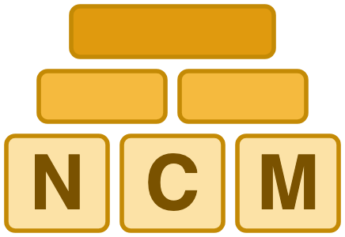
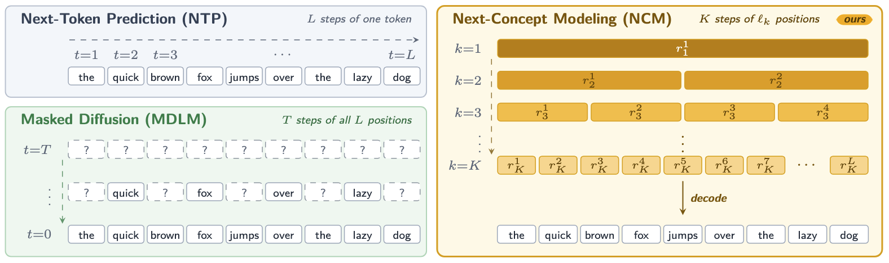
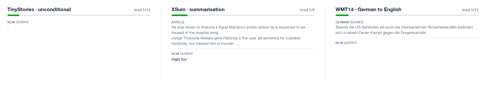
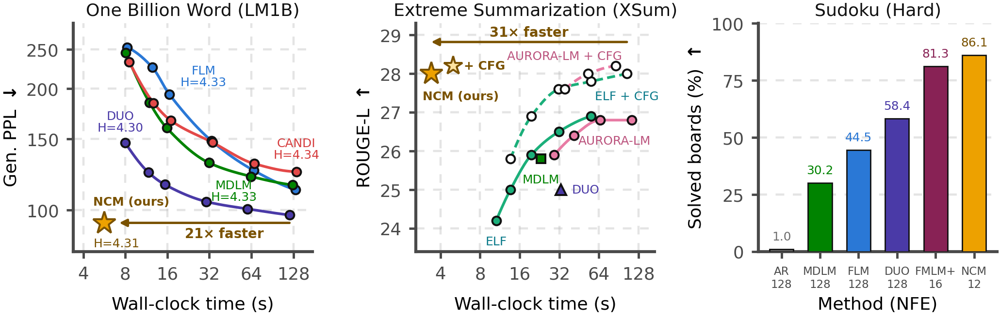

<h1 align="center"> Next-Concept Modeling</h1>

<p align="center"><strong>Fast, Parallel Coarse-to-Fine Text Generation</strong></p>

<p align="center">
  <a href="https://arxiv.org/abs/2610.14162"></a>
  <a href="https://huggingface.co/collections/hazyresearch/ncm"></a>
  <a href="https://hazyresearch.stanford.edu/blog/2026-10-12-ncm"></a>
  <a href="https://scalingintelligence.stanford.edu/blogs/ncm/"></a>
  <a href="https://x.com/KumbongHermann"></a>
  <a href="LICENSE"></a>
</p>

Next-Concept Modeling (NCM) is a two-stage framework for parallel text generation. A multiscale residual VQ tokenizer represents a sequence as a hierarchy of discrete codes, and a transformer predicts that hierarchy from coarse to fine. Positions within a level are generated in parallel, so generation requires one forward evaluation per level.

<p align="center">
  
</p>

## Highlights

### Coarse-to-fine generation

NCM generates coarse to fine: each level predicts a longer sequence in parallel, and decoding every level shows a sample being refined from a rough sketch to the full output in a few steps.

<p align="center"></p>

### Quality at a fraction of the cost

NCM beats or matches strong diffusion baselines on different tasks & datasets while generating 9-31× faster.

<p align="center">
  
</p>

## Released models

Weights and tokenized datasets are hosted in the [NCM Hugging Face collection](https://huggingface.co/collections/hazyresearch/ncm). Each released model consists of a frozen tokenizer and a next-concept generator.

<table>
  <thead>
    <tr><th>Task</th><th>Model</th><th>Tokenizer</th><th>Generator</th><th>Config</th><th>Data</th></tr>
  </thead>
  <tbody>
    <tr><td rowspan="1"><b>XSum</b></td><td>&ndash;</td><td><a href="https://huggingface.co/hazyresearch/ncm-checkpoints/blob/main/xsum/tokenizer.pt">tokenizer.pt</a></td><td><a href="https://huggingface.co/hazyresearch/ncm-checkpoints/blob/main/xsum/generator.pt">generator.pt</a></td><td><a href="https://huggingface.co/hazyresearch/ncm-checkpoints/blob/main/xsum/config.yaml">config.yaml</a></td><td rowspan="1"><a href="https://huggingface.co/datasets/hazyresearch/ncm-datasets/tree/main/xsum">test set</a></td></tr>
    <tr><td rowspan="1"><b>WMT14 De&ndash;En</b></td><td>&ndash;</td><td><a href="https://huggingface.co/hazyresearch/ncm-checkpoints/blob/main/wmt14/tokenizer.pt">tokenizer.pt</a></td><td><a href="https://huggingface.co/hazyresearch/ncm-checkpoints/blob/main/wmt14/generator.pt">generator.pt</a></td><td><a href="https://huggingface.co/hazyresearch/ncm-checkpoints/blob/main/wmt14/config.yaml">config.yaml</a></td><td rowspan="1"><a href="https://huggingface.co/datasets/hazyresearch/ncm-datasets/tree/main/wmt14">test set</a></td></tr>
    <tr><td rowspan="3"><b>Sudoku</b></td><td>easy</td><td><a href="https://huggingface.co/hazyresearch/ncm-checkpoints/blob/main/sudoku/easy/tokenizer.pt">tokenizer.pt</a></td><td><a href="https://huggingface.co/hazyresearch/ncm-checkpoints/blob/main/sudoku/easy/generator.pt">generator.pt</a></td><td><a href="https://huggingface.co/hazyresearch/ncm-checkpoints/blob/main/sudoku/easy/config.yaml">config.yaml</a></td><td rowspan="3"><a href="https://huggingface.co/datasets/hazyresearch/ncm-datasets/tree/main/sudoku">test boards</a></td></tr>
    <tr><td>medium</td><td><a href="https://huggingface.co/hazyresearch/ncm-checkpoints/blob/main/sudoku/medium/tokenizer.pt">tokenizer.pt</a></td><td><a href="https://huggingface.co/hazyresearch/ncm-checkpoints/blob/main/sudoku/medium/generator.pt">generator.pt</a></td><td><a href="https://huggingface.co/hazyresearch/ncm-checkpoints/blob/main/sudoku/medium/config.yaml">config.yaml</a></td></tr>
    <tr><td>hard</td><td><a href="https://huggingface.co/hazyresearch/ncm-checkpoints/blob/main/sudoku/hard/tokenizer.pt">tokenizer.pt</a></td><td><a href="https://huggingface.co/hazyresearch/ncm-checkpoints/blob/main/sudoku/hard/generator.pt">generator.pt</a></td><td><a href="https://huggingface.co/hazyresearch/ncm-checkpoints/blob/main/sudoku/hard/config.yaml">config.yaml</a></td></tr>
    <tr><td rowspan="3"><b>LM1B</b></td><td>small</td><td rowspan="3"><a href="https://huggingface.co/hazyresearch/ncm-checkpoints/blob/main/lm1b/tokenizer.pt">tokenizer.pt</a></td><td><a href="https://huggingface.co/hazyresearch/ncm-checkpoints/blob/main/lm1b/small/generator.pt">generator.pt</a></td><td><a href="https://huggingface.co/hazyresearch/ncm-checkpoints/blob/main/lm1b/small/config.yaml">config.yaml</a></td><td rowspan="3"><a href="https://huggingface.co/datasets/hazyresearch/ncm-datasets/tree/main/lm1b">tokenized text</a></td></tr>
    <tr><td>medium</td><td><a href="https://huggingface.co/hazyresearch/ncm-checkpoints/blob/main/lm1b/medium/generator.pt">generator.pt</a></td><td><a href="https://huggingface.co/hazyresearch/ncm-checkpoints/blob/main/lm1b/medium/config.yaml">config.yaml</a></td></tr>
    <tr><td>large</td><td><a href="https://huggingface.co/hazyresearch/ncm-checkpoints/blob/main/lm1b/large/generator.pt">generator.pt</a></td><td><a href="https://huggingface.co/hazyresearch/ncm-checkpoints/blob/main/lm1b/large/config.yaml">config.yaml</a></td></tr>
    <tr><td rowspan="1"><b>TinyStories</b></td><td>&ndash;</td><td><a href="https://huggingface.co/hazyresearch/ncm-checkpoints/blob/main/tinystories/tokenizer.pt">tokenizer.pt</a></td><td><a href="https://huggingface.co/hazyresearch/ncm-checkpoints/blob/main/tinystories/generator.pt">generator.pt</a></td><td><a href="https://huggingface.co/hazyresearch/ncm-checkpoints/blob/main/tinystories/config.yaml">config.yaml</a></td><td rowspan="1"><a href="https://huggingface.co/datasets/hazyresearch/ncm-datasets/tree/main/tinystories">tokenized text</a></td></tr>
    <tr><td rowspan="1"><b>OpenWebText</b></td><td>&ndash;</td><td><a href="https://huggingface.co/hazyresearch/ncm-checkpoints/blob/main/owt/tokenizer.pt">tokenizer.pt</a></td><td><a href="https://huggingface.co/hazyresearch/ncm-checkpoints/blob/main/owt/generator.pt">generator.pt</a></td><td><a href="https://huggingface.co/hazyresearch/ncm-checkpoints/blob/main/owt/config.yaml">config.yaml</a></td><td rowspan="1"><a href="https://huggingface.co/datasets/hazyresearch/ncm-datasets/tree/main/owt">tokenized text</a></td></tr>
  </tbody>
</table>

## Installation

```bash
git clone https://github.com/HazyResearch/ncm.git
cd ncm
pip install -r requirements.txt
```

Python 3.10 or newer and a CUDA-capable PyTorch installation are recommended.

## Evaluation

Download the checkpoints and evaluation inputs:

```bash
hf download hazyresearch/ncm-checkpoints --local-dir artifacts
hf download hazyresearch/ncm-datasets --repo-type dataset --local-dir data
```

Then run:

```bash
python evaluate.py --config config/eval/<task>.yaml --checkpoint-dir artifacts/<task> --data-dir data/<task>
# <task> is one of xsum, wmt14, sudoku-easy, sudoku-medium or sudoku-hard

python evaluate.py --config config/eval/<dataset>.yaml --checkpoint-dir artifacts/<dataset>
# <dataset> is tinystories, owt or lm1b-<size> with <size> one of small, medium or large
```

This runs one generation shard per visible GPU, merges them, and prints ROUGE-1/2/L and generative perplexity for XSum; cased and lowercased sacreBLEU, chrF and length ratio for WMT14; solved, cell and valid-grid rates for Sudoku; and generative perplexity under GPT-2 large with unigram entropy, over 5 seeds of 256 unconditional samples, for TinyStories, OpenWebText and LM1B, the latter under the FLM scoring protocol. Add `--cfg <scale>` for classifier-free guidance on XSum and WMT14; the guided WMT14 row uses `--cfg 1.0`.

## Repository layout

- `evaluate.py`: evaluation entry point
- `scripts/`: per-GPU generation shard and the merge that scores it
- `config/eval/`: one config per released checkpoint, identical to the `config.yaml` shipped with it
- `models/`, `tokenization/`: generator and tokenizer implementations

## Citation

```bibtex
@misc{kumbong2026nextconcept,
      title={Next-Concept Modeling: Fast, Parallel Coarse-to-Fine Text Generation},
      author={Hermann Kumbong and Ishan S. Khare and Iddah Mlauzi and Andrew Woen and Charles Ding and E. Kelly Buchanan and Simran Arora and Azalia Mirhoseini and Christopher Ré},
      year={2026},
      eprint={2610.14162},
      archivePrefix={arXiv},
      primaryClass={cs.CL},
      url={https://arxiv.org/abs/2610.14162},
}
```

Released under the [MIT license](LICENSE).
